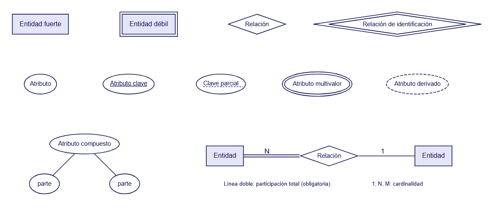
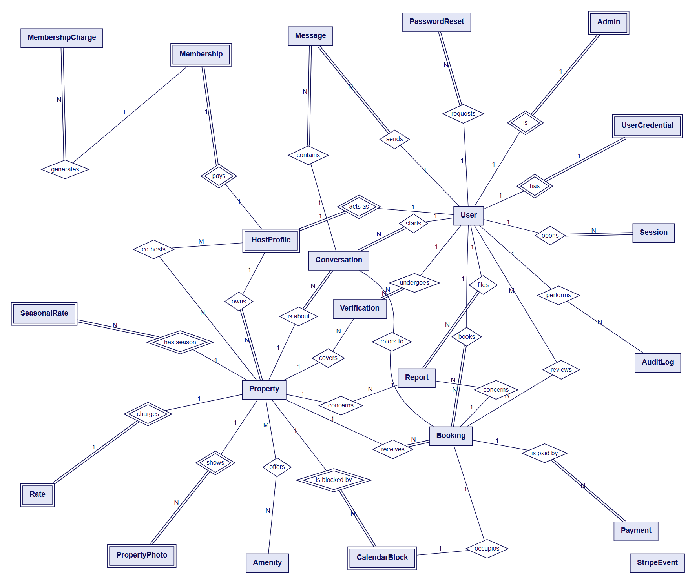
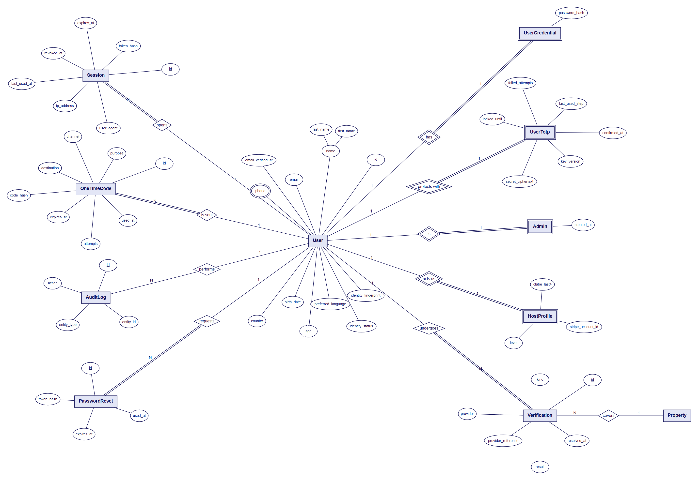
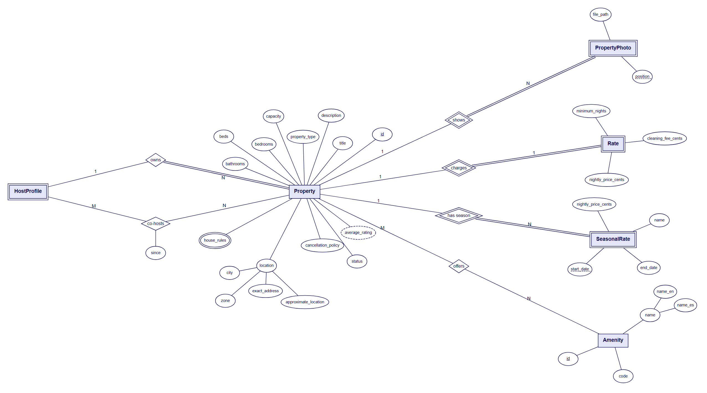
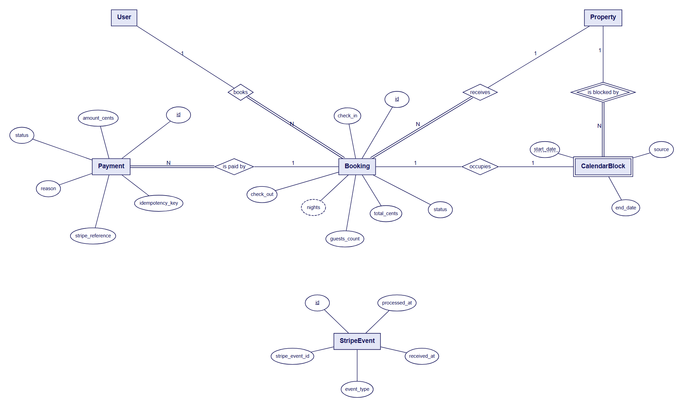
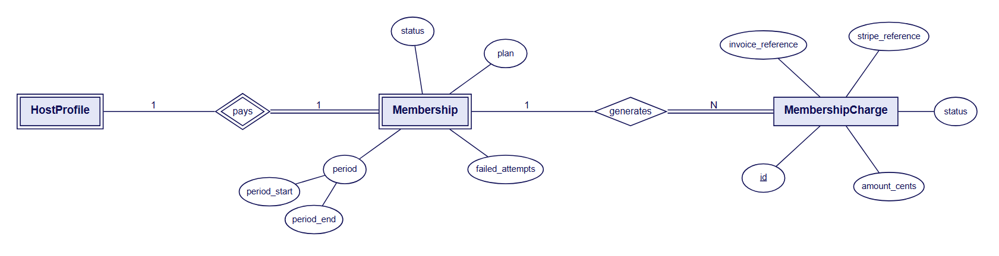
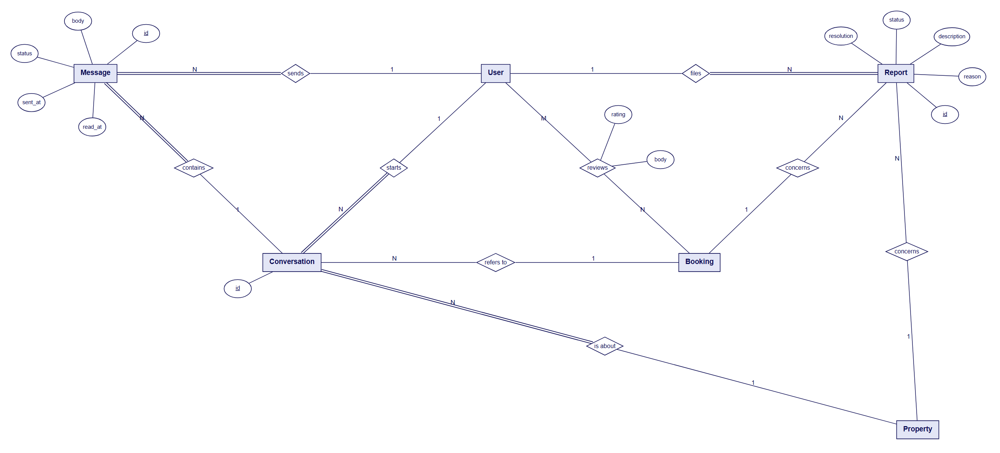

# Modelo de datos de Íntegro

Diagrama entidad-relación y modelo relacional de la base de datos. Es el plano que sigue la programación: cada tabla se construye como una migración en `database/migrations/`, grupo por grupo.

Este documento sustituye a la tabla de la sección 5 de `docs/arquitectura.md`.

## 1. Convenciones

- Motor: PostgreSQL. Nombres de tablas, columnas y valores en inglés.
- Toda tabla lleva `id` (UUID generado) como llave primaria, `created_at` y `updated_at`. En el modelo relacional de la sección 4 esas dos fechas no se repiten.
- Los montos se guardan en centavos enteros (`_cents`).
- Una llave foránea escrita como `columna → tabla(columna)` significa que el valor debe existir en la otra tabla.
- Nada se borra en cascada: una fila con datos ligados no se puede borrar.
- Estado de cada tabla: **construida** (ya existe su migración con pruebas) o **diseñada** (falta construirla).

## 2. Diagrama entidad-relación

Modelo conceptual en notación de Chen. Los nombres van en inglés y coinciden con los del modelo relacional de la sección 4: cada entidad corresponde a una tabla y cada óvalo a una columna, salvo lo que se indica en la sección 2.8.

### 2.1 Simbología

| Figura | Significa |
|---|---|
| Rectángulo | Entidad fuerte: existe por sí misma y tiene clave propia |
| Rectángulo doble | Entidad débil: no existe sin su entidad dueña y se identifica a través de ella |
| Rombo | Relación entre entidades |
| Rombo doble | Relación de identificación: la que une a una entidad débil con su dueña |
| Óvalo | Atributo |
| Óvalo con texto subrayado | Atributo clave |
| Óvalo con subrayado punteado | Clave parcial de una entidad débil: distingue a una fila solo dentro de su dueña |
| Óvalo doble | Atributo multivalor: puede tener varios valores |
| Óvalo punteado | Atributo derivado: se calcula a partir de otros y no se guarda |
| Óvalo con óvalos colgando | Atributo compuesto: se divide en partes |
| Línea doble | Participación total: la entidad no puede existir sin esa relación |
| 1, N, M sobre la línea | Cardinalidad de la entidad en la relación |

### 2.2 Diagrama general

Todas las entidades y relaciones, sin atributos. Los atributos están en los diagramas de detalle.

`StripeEvent` no participa en ninguna relación: solo recuerda qué avisos de Stripe ya se procesaron.

### 2.3 Personas y acceso

- Entidades débiles: `UserCredential`, `Admin` y `HostProfile`. Las tres dependen de `User` con relación de identificación de uno a uno, por eso no llevan clave parcial.
- Atributo compuesto: `name` (`first_name`, `last_name`).
- Atributo multivalor: `phone`.
- Atributo derivado: `age`, que se calcula con `birth_date`.
- `identity_fingerprint`: huella irreversible de la identidad verificada. No es el documento ni permite reconstruirlo.
- `email_verified_at`: fecha en que la persona comprobó su correo. Vacía mientras no lo haya hecho.
- `Session`, `PasswordReset` y `OneTimeCode` son entidades fuertes: cada una tiene su clave `id` y se relaciona con `User` de uno a muchos, con participación total, porque ninguna existe sin una persona.
- `OneTimeCode`: los códigos de un solo uso que se le envían a la persona (relación `is sent`). `Session` guarda además desde dónde se abrió la sesión: `ip_address`, `user_agent` y `last_used_at`.

### 2.4 Propiedades

- Entidades débiles: `PropertyPhoto` (clave parcial `position`), `SeasonalRate` (clave parcial `start_date`) y `Rate` (uno a uno, sin clave parcial). Las tres dependen de `Property`.
- Relación con atributo: `co-hosts`, de muchos a muchos entre `HostProfile` y `Property`, con el atributo `since`.
- Relación de muchos a muchos sin atributos: `offers`, entre `Property` y `Amenity`.
- Atributos compuestos: `location` (`city`, `zone`, `exact_address`, `approximate_location`) en `Property` y `name` (`name_es`, `name_en`) en `Amenity`.
- Atributo multivalor: `house_rules`.
- Atributo derivado: `average_rating`, que se calcula con las reseñas.

### 2.5 Reservas y pagos

- Entidad débil: `CalendarBlock` (clave parcial `start_date`), que depende de `Property`.
- Atributo derivado: `nights`, que se calcula con `check_in` y `check_out`.

### 2.6 Membresías

- Entidad débil: `Membership`, que depende de `HostProfile` con relación de identificación de uno a uno.
- Atributo compuesto: `period` (`period_start`, `period_end`).

### 2.7 Mensajes, reseñas y reportes

- Relación con atributos: `reviews`, de muchos a muchos entre `User` y `Booking`, con los atributos `rating` y `body`.

### 2.8 Cómo se convierte al modelo relacional

| En el diagrama | En el modelo relacional |
|---|---|
| Entidad fuerte | Una tabla con su clave `id`. |
| Entidad débil | Una tabla con la llave foránea de su dueña. Por convención del proyecto también lleva `id`; la identificación del diagrama se conserva con una regla de valor único: la llave foránea sola cuando es de uno a uno, o la llave foránea junto con la clave parcial. |
| Relación de uno a uno o de uno a muchos | Una llave foránea en el lado "muchos" (o en la entidad débil). |
| Relación de muchos a muchos | Una tabla intermedia con las dos llaves foráneas y sus atributos: `co-hosts` es `property_co_hosts` (su atributo `since` es `created_at`), `offers` es `property_amenities` y `reviews` es `reviews`. |
| Atributo compuesto | Una columna por cada parte; el óvalo padre no se guarda. |
| Atributo derivado | No se guarda: `age`, `nights` y `average_rating` se calculan al consultarlos. |
| Atributo multivalor | Una tabla aparte con la llave foránea de la entidad y un valor por fila. |

Los dos atributos multivalor del diagrama:

- `phone`: confirmado como multivalor el 17 de noviembre de 2026. Es la tabla `user_phones`; el correo sigue siendo uno solo por persona.
- `house_rules`: confirmado como multivalor el 17 de noviembre de 2026. Es la tabla `property_house_rules`, con una regla por fila.

### 2.9 Cómo se regeneran las imágenes

Los diagramas se generan desde `tools/er-diagram/generate.mjs`, que contiene la lista de entidades, atributos y relaciones. Las instrucciones están al inicio de ese archivo.

## 3. Relaciones y cardinalidad

"Obligatoria" indica si la llave foránea puede quedar vacía. En las relaciones de uno a uno, la columna con la llave foránea es única, y eso es lo que impide una segunda fila.

### Uno a uno

| Relación | Llave foránea | Obligatoria | Cómo se lee |
|---|---|---|---|
| `users` y `user_credentials` | `user_credentials.user_id → users(id)`, única | Sí | Una persona tiene una sola contraseña. Que toda persona tenga contraseña lo garantiza el registro, que guarda las dos filas juntas. |
| `users` y `admins` | `admins.user_id → users(id)`, única | Sí | Una persona puede ser administradora o no. |
| `users` y `host_profiles` | `host_profiles.user_id → users(id)`, única | Sí | Una persona puede ser anfitriona o no; si lo es, tiene un solo perfil. |
| `host_profiles` y `memberships` | `memberships.host_id → host_profiles(user_id)`, única | Sí | Un anfitrión tiene una sola membresía; si deja de pagar y vuelve, se reactiva la misma. |
| `properties` y `rates` | `rates.property_id → properties(id)`, única | Sí | Una propiedad tiene una sola tarifa base. |
| `bookings` y `calendar_blocks` | `calendar_blocks.booking_id → bookings(id)`, única | No | Una reserva ocupa un solo bloqueo del calendario. Los bloqueos manuales o de iCal no tienen reserva. |

### Uno a muchos

| Uno | Muchos | Llave foránea | Obligatoria | Cómo se lee |
|---|---|---|---|---|
| `users` | `user_phones` | `user_phones.user_id → users(id)` | Sí | Una persona registra varios teléfonos; uno es el principal. Sale del atributo multivalor `phone` del diagrama. |
| `users` | `sessions` | `sessions.user_id → users(id)` | Sí | Una persona puede tener varias sesiones abiertas (celular y computadora). |
| `users` | `password_resets` | `password_resets.user_id → users(id)` | Sí | Una persona puede pedir recuperar su contraseña varias veces. |
| `users` | `login_attempts` | `login_attempts.user_id → users(id)` | No | Una cuenta recibe muchos intentos de inicio de sesión. Vacía cuando el correo que se escribió no tiene cuenta. |
| `users` | `one_time_codes` | `one_time_codes.user_id → users(id)` | Sí | A una persona se le envían varios códigos de un solo uso: para iniciar sesión, para comprobar su correo y para comprobar un teléfono. |
| `users` | `verifications` | `verifications.user_id → users(id)` | Sí | Una persona pasa por varias verificaciones: identidad, cuenta bancaria, tarjeta. |
| `properties` | `verifications` | `verifications.property_id → properties(id)` | No | Una propiedad pasa por varias verificaciones. Vacía cuando se verifica a la persona y no a una propiedad. |
| `host_profiles` | `properties` | `properties.owner_id → host_profiles(user_id)` | Sí | Un anfitrión es titular de varias propiedades; cada propiedad tiene un solo titular, que paga la membresía y recibe el dinero. |
| `properties` | `property_photos` | `property_photos.property_id → properties(id)` | Sí | Una propiedad tiene varias fotos. |
| `properties` | `property_house_rules` | `property_house_rules.property_id → properties(id)` | Sí | Una propiedad tiene varias reglas de la casa. Sale del atributo multivalor `house_rules` del diagrama. |
| `properties` | `seasonal_rates` | `seasonal_rates.property_id → properties(id)` | Sí | Una propiedad tiene varias temporadas de precio. |
| `properties` | `calendar_blocks` | `calendar_blocks.property_id → properties(id)` | Sí | Una propiedad tiene varios periodos bloqueados. |
| `properties` | `bookings` | `bookings.property_id → properties(id)` | Sí | Una propiedad recibe varias reservas. |
| `users` | `bookings` | `bookings.guest_id → users(id)` | Sí | Un huésped hace varias reservas. |
| `bookings` | `payments` | `payments.booking_id → bookings(id)` | Sí | Una reserva puede tener varios movimientos: el cobro, un reintento, un reembolso. |
| `memberships` | `membership_charges` | `membership_charges.membership_id → memberships(id)` | Sí | Una membresía genera un cobro por mes. |
| `properties` | `conversations` | `conversations.property_id → properties(id)` | Sí | Sobre una propiedad hay varias conversaciones, una por huésped. |
| `users` | `conversations` | `conversations.guest_id → users(id)` | Sí | Un huésped abre varias conversaciones, una por propiedad. |
| `bookings` | `conversations` | `conversations.booking_id → bookings(id)` | No | La conversación se liga a la reserva cuando existe; antes de reservar está vacía. |
| `conversations` | `messages` | `messages.conversation_id → conversations(id)` | Sí | Una conversación contiene varios mensajes. |
| `users` | `messages` | `messages.sender_id → users(id)` | Sí | Una persona envía varios mensajes. |
| `users` | `reports` | `reports.reporter_id → users(id)` | Sí | Una persona puede levantar varios reportes. |
| `bookings` | `reports` | `reports.booking_id → bookings(id)` | No | Un reporte puede tratar de una reserva. |
| `properties` | `reports` | `reports.property_id → properties(id)` | No | Un reporte puede tratar de un anuncio sin que exista reserva. |
| `users` | `audit_log` | `audit_log.actor_id → users(id)` | No | Una persona deja varias entradas en la bitácora. Vacía cuando actuó el sistema. |

### Muchos a muchos

Una relación de muchos a muchos no se puede guardar con una sola llave foránea. Se resuelve con una tabla intermedia que tiene dos llaves foráneas, y la pareja no se puede repetir.

| Entre | Tabla intermedia | Llaves foráneas | Cómo se lee |
|---|---|---|---|
| `host_profiles` y `properties` (coanfitriones) | `property_co_hosts` | `property_id → properties(id)` y `host_id → host_profiles(user_id)`; la pareja es única | Una propiedad tiene varios coanfitriones y un anfitrión ayuda en varias propiedades. El coanfitrión edita, responde mensajes y maneja el calendario; no toca dinero. |
| `properties` y `amenities` | `property_amenities` | `property_id → properties(id)` y `amenity_id → amenities(id)`; la pareja es única | Una propiedad ofrece varios servicios y un servicio (wifi, cocina) se ofrece en muchas propiedades. |
| `users` y `bookings` (reseñas) | `reviews` | `author_id → users(id)` y `booking_id → bookings(id)`; la pareja es única | Una persona reseña varias reservas y una reserva recibe hasta dos reseñas: la del huésped y la del anfitrión. La relación lleva los atributos `rating` y `body`. |

## 4. Modelo relacional

Notación: `tabla(columnas)`. La llave primaria va <ins>subrayada</ins>. `FK` marca una llave foránea, `UK` un valor único y `?` una columna que puede quedar vacía.

### Grupo 1. Personas y acceso

Estado: `users`, `user_credentials`, `user_phones`, `host_profiles`, `verifications`, `sessions`, `password_resets`, `one_time_codes`, `login_attempts` y `admins` construidas.

- **users**(<ins>id</ins>, first_name, last_name, email UK, email_verified_at?, country, birth_date, preferred_language, identity_status, identity_fingerprint? UK)
  - `email_verified_at` queda vacía hasta que la persona escribe el código que se le envió al correo. La escribe solo el sistema.
  - `identity_fingerprint` está diseñada, todavía no construida: se agrega con su propia migración cuando la parte legal la confirme.
- **user_phones**(<ins>id</ins>, user_id FK → users(id), phone UK, is_primary, verified_at?)
  - Cada persona tiene exactamente un teléfono principal. Un teléfono no se repite en toda la plataforma.
- **user_credentials**(<ins>id</ins>, user_id FK UK → users(id), password_hash)
- **sessions**(<ins>id</ins>, user_id FK → users(id), token_hash UK, expires_at, revoked_at?, last_used_at, ip_address?, user_agent?)
  - Una sesión sirve mientras no haya vencido y `revoked_at` siga vacía. La persona lee sus propias sesiones, sin `token_hash`; las escribe solo el sistema.
  - `ip_address` y `user_agent` dicen desde dónde se abrió la sesión. Son datos personales y van en el aviso de privacidad.
- **password_resets**(<ins>id</ins>, user_id FK → users(id), token_hash UK, expires_at, used_at?)
  - Solo la lee y la escribe el sistema.
- **one_time_codes**(<ins>id</ins>, user_id FK → users(id), purpose, channel, destination, code_hash, expires_at, attempts, used_at?)
  - `purpose` dice para qué es el código: `login`, `verify_email` o `verify_phone`. `channel` dice por dónde salió: `email`, `sms` o `whatsapp`. El correo se comprueba por correo y el teléfono por SMS o WhatsApp.
  - `destination` es el correo o el teléfono al que se envió, con el mismo formato que `users.email` y `user_phones.phone`.
  - `code_hash` no es único: un código de seis dígitos se repite entre personas. Solo la lee y la escribe el sistema.
  - En las tres tablas, `token_hash` y `code_hash` son un SHA-256 en hexadecimal (64 caracteres) y el sistema no borra filas: una sesión se cierra con `revoked_at` y un código o una recuperación se gastan con `used_at`.
- **login_attempts**(<ins>id</ins>, email?, user_id? FK → users(id), succeeded, ip_address?, user_agent?)
  - Una fila por cada vez que alguien escribe un correo y una contraseña, acierte o no. Sirve para contar los fallos seguidos: un acierto reinicia la cuenta. `user_id` queda vacío si el correo no tiene cuenta, y `email` si lo escrito no tenía forma de correo.
  - Solo se agregan filas; el sistema no las cambia ni las borra, y la persona no las ve. No lleva `updated_at` porque una fila nunca cambia.
- **admins**(<ins>id</ins>, user_id FK UK → users(id))
  - Las altas y las bajas las hace solo el dueño de la base, a mano. El sistema solo lee la tabla; la persona puede leer su propia fila.
- **host_profiles**(<ins>id</ins>, user_id FK UK → users(id), level, stripe_account_id? UK, clabe_last4?)
- **verifications**(<ins>id</ins>, user_id FK → users(id), property_id? FK → properties(id), kind, provider, provider_reference, result, resolved_at?)
  - Única la pareja (provider, provider_reference). `property_id` se agrega en el grupo 2.

### Grupo 2. Propiedades

Estado: diseñadas.

- **properties**(<ins>id</ins>, owner_id FK → host_profiles(user_id), title, description, property_type, capacity, bedrooms, beds, bathrooms, city, zone, exact_address, approximate_location, cancellation_policy, status)
- **property_co_hosts**(<ins>id</ins>, property_id FK → properties(id), host_id FK → host_profiles(user_id))
  - Única la pareja (property_id, host_id).
- **property_house_rules**(<ins>id</ins>, property_id FK → properties(id), rule, position)
  - Única la pareja (property_id, position).
- **property_photos**(<ins>id</ins>, property_id FK → properties(id), file_path, position)
  - Única la pareja (property_id, position).
- **rates**(<ins>id</ins>, property_id FK UK → properties(id), nightly_price_cents, cleaning_fee_cents, minimum_nights)
- **seasonal_rates**(<ins>id</ins>, property_id FK → properties(id), name, start_date, end_date, nightly_price_cents)
  - Dos temporadas de la misma propiedad no se pueden encimar.
- **amenities**(<ins>id</ins>, code UK, name_es, name_en)
- **property_amenities**(<ins>id</ins>, property_id FK → properties(id), amenity_id FK → amenities(id))
  - Única la pareja (property_id, amenity_id).

### Grupo 3. Calendario y reservas

Estado: diseñadas.

- **calendar_blocks**(<ins>id</ins>, property_id FK → properties(id), booking_id? FK UK → bookings(id), start_date, end_date, source)
  - `source`: manual, ical o booking. Dos bloqueos de la misma propiedad no se pueden encimar.
- **bookings**(<ins>id</ins>, property_id FK → properties(id), guest_id FK → users(id), check_in, check_out, guests_count, total_cents, status)

### Grupo 4. Pagos

Estado: diseñadas.

- **payments**(<ins>id</ins>, booking_id FK → bookings(id), amount_cents, status, reason?, stripe_reference? UK, idempotency_key UK)
- **stripe_events**(<ins>id</ins>, stripe_event_id UK, event_type, received_at, processed_at?)

### Grupo 5. Membresías

Estado: diseñadas.

- **memberships**(<ins>id</ins>, host_id FK UK → host_profiles(user_id), plan, status, period_start, period_end, failed_attempts)
- **membership_charges**(<ins>id</ins>, membership_id FK → memberships(id), amount_cents, status, stripe_reference? UK, invoice_reference?)

### Grupo 6. Mensajes, reseñas, reportes y bitácora

Estado: diseñadas.

- **conversations**(<ins>id</ins>, property_id FK → properties(id), guest_id FK → users(id), booking_id? FK → bookings(id))
  - Única la pareja (property_id, guest_id).
- **messages**(<ins>id</ins>, conversation_id FK → conversations(id), sender_id FK → users(id), body, status, sent_at, read_at?)
  - `status`: sent, read o held.
- **reviews**(<ins>id</ins>, booking_id FK → bookings(id), author_id FK → users(id), rating, body)
  - Única la pareja (booking_id, author_id).
- **reports**(<ins>id</ins>, reporter_id FK → users(id), booking_id? FK → bookings(id), property_id? FK → properties(id), reason, description, status, resolution?)
- **audit_log**(<ins>id</ins>, actor_id? FK → users(id), action, entity_type, entity_id)
  - Solo se inserta; nunca se edita ni se borra.

## 5. Decisiones del modelo

Aceptadas por Sophia el 17 de noviembre de 2026.

| # | Decisión | Por qué |
|---|---|---|
| 1 | El titular va en `properties.owner_id` y los coanfitriones en `property_co_hosts` | Así la base garantiza que cada propiedad tiene exactamente un titular. |
| 2 | Las llaves foráneas de anfitrión apuntan a `host_profiles(user_id)` y no a `users(id)` | Nadie puede ser titular, coanfitrión o tener membresía sin perfil de anfitrión. |
| 3 | `conversations` no lleva columna de anfitrión | Con coanfitriones, el lado anfitrión es quien atienda la propiedad; quién escribió queda en `messages.sender_id`. |
| 4 | `calendar_blocks.booking_id` | Liga el bloqueo con la reserva que lo causó, para liberarlo si la reserva se cancela. |
| 5 | `reports.property_id` | El prototipo tiene "Reportar este anuncio", que ocurre sin reserva. |
| 6 | Columnas de `sessions` y `password_resets` | Se guarda la huella del código, no el código, igual que con las contraseñas. |
| 7 | `amenities` con `name_es` y `name_en` | La plataforma funciona en español e inglés. |
| 8 | Nombres `memberships` y `membership_charges` | `docs/arquitectura.md` las llamaba `subscriptions` e `invoices`. |
| 9 | Teléfono multivalor y correo único | Si la persona pierde, cambia o le roban el teléfono conserva otro con el cual entrar; el correo es uno solo porque con él inicia sesión. |
| 10 | Entidades débiles: `UserCredential`, `Admin`, `HostProfile`, `Rate`, `Membership`, `PropertyPhoto`, `SeasonalRate` y `CalendarBlock` | Ninguna existe sin su entidad dueña. |
| 11 | `reviews` es una relación de muchos a muchos con atributos, no una entidad | Una reseña solo existe entre una persona y una reserva. |
| 12 | `house_rules` en la tabla `property_house_rules` | Una regla por fila se puede ordenar, traducir y usar como filtro de búsqueda. |
| 13 | Huella única de la identidad verificada (`users.identity_fingerprint`) | Detecta a una misma persona con dos cuentas aunque use otro correo y otro teléfono; si la huella se repite, la cuenta se manda a revisión y no se bloquea sola. Sujeta a revisión legal. |
| 14 | El generador de los diagramas vive en `tools/er-diagram/` | Cuando cambia el modelo se corrige la lista y las imágenes se regeneran. |
| 15 | La sesión se guarda en la tabla `sessions`, no en un pase firmado (JWT) | Cerrar sesión la revoca y la llave deja de servir en ese instante; también se puede cerrar la sesión de un celular robado. `docs/arquitectura.md` decía JWT. |
| 16 | `sessions` guarda `ip_address`, `user_agent` y `last_used_at` | Para mostrarle a la persona dónde tiene sesión iniciada y para detectar accesos sospechosos. Son datos personales. |
| 17 | Los códigos de un solo uso van en su propia tabla, `one_time_codes`; `password_resets` se queda como estaba | El inicio de sesión del ADR 0014 envía códigos por correo, SMS o WhatsApp y hay que guardar su huella para comprobarlos. |
| 18 | Fecha de comprobación del correo en `users.email_verified_at` | La base distingue un correo comprobado de uno que no, igual que con los teléfonos. |
| 19 | La persona lee sus propias sesiones, sin la huella; los códigos y las recuperaciones solo los ve el sistema | Lo mínimo que hace falta para la pantalla de sesiones abiertas. |

| 20 | Cada intento de inicio de sesión se guarda en `login_attempts`, con el correo, la dirección IP y el navegador | La cuenta nunca se bloquea: a los 3 fallos se avisa al dueño y a los 6 quien está intentando espera 15 minutos, por dispositivo y dirección (ADR 0014). Para contar hay que guardar. |
| 21 | `login_attempts` solo admite filas nuevas | Es un registro: ni el sistema lo cambia ni lo borra. |
| 22 | Los administradores se dan de alta solo a mano, por el dueño de la base | La API no tiene permiso de escribir en `admins`, ni siquiera actuando como el sistema: quien tome el control de la API no puede hacerse administrador. |

Las decisiones 15 a 19 son del 17 de noviembre de 2026, al construir las tablas de acceso a la cuenta. Las decisiones 20 a 22 son del 18 de noviembre de 2026.

## 6. Tablas de estados

Pagos, membresías, propiedades y reservas son máquinas de estados cerradas: todo cambio que no esté en su tabla está prohibido y tiene su prueba. Las de pagos, membresías y propiedades fueron aceptadas el 17 de noviembre de 2026.

### 6.1 Pagos (`payments.status`)

| De | A | Quién lo dispara |
|---|---|---|
| `created` | `pending` | El huésped confirma la reserva y Stripe crea el intento de cobro |
| `pending` | `paid` | Aviso firmado de Stripe: cobro exitoso |
| `pending` | `rejected` | Aviso firmado de Stripe: cobro fallido, con el motivo que da Stripe |
| `pending` | `expired` | 30 minutos sin confirmación |
| `paid` | `cancelled` | El huésped cancela; aplica la política de cancelación de la propiedad |
| `paid` | `refunded` | Reembolso ejecutado en Stripe, parcial o total |

### 6.2 Membresías (`memberships.status`)

| Estado | Cuándo | Qué pasa con las propiedades |
|---|---|---|
| `active` | Stripe confirma el pago del mes | Visibles |
| `grace` | El cobro falló; días 1 a 7, con tres reintentos y avisos | Visibles |
| `suspended` | Día 8 sin pago | Ocultas, con los datos intactos; el anfitrión ve un aviso para pagar |
| `cancelled` | Día 30 sin pago | Ocultas; si vuelve, paga y se reactiva sin verificarse de nuevo |

Los días (7, 8 y 30) viven en una configuración, no en el código. Falta escribir la tabla de cambios permitidos entre estos estados antes de construir el grupo 5.

### 6.3 Propiedades (`properties.status`)

Estados: `draft` (borrador), `in_review` (en revisión), `active` (activa), `paused` (pausada por el anfitrión), `suspended` (suspendida por la plataforma) y `removed` (retirada).

Una propiedad está activa solo si se cumplen tres cosas a la vez: su verificación está aprobada, la membresía del titular está `active` o `grace`, y el anfitrión no la pausó. En cuanto una falla, la propiedad se oculta sola.

Falta escribir la tabla de cambios permitidos entre estos estados antes de construir el grupo 2.

### 6.4 Reservas (`bookings.status`)

Sin definir. Necesita su lista de estados y su tabla de cambios antes de construir el grupo 3.

## 7. Lo que falta decidir antes de construir

- **Estados de las reservas** y las tablas de cambios permitidos de membresías y propiedades (sección 6).
- **Huella de identidad:** la revisión legal y comprobar que el proveedor de verificación entrega un dato estable para calcularla.
- **Tablas que no están en este modelo:** calendarios iCal por propiedad, llaves digitales y registro de aperturas de la chapa inteligente y eventos de uso (búsquedas, clics).
- **Diagrama de Chen:** falta agregar `login_attempts` y regenerar las imágenes de la sección 2.