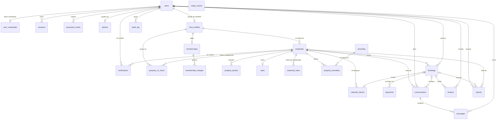
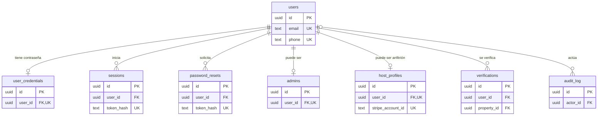
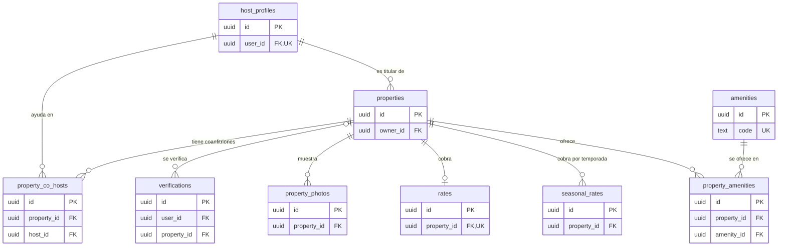
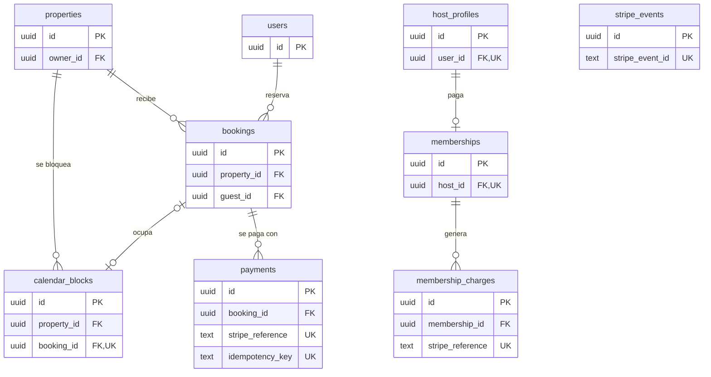
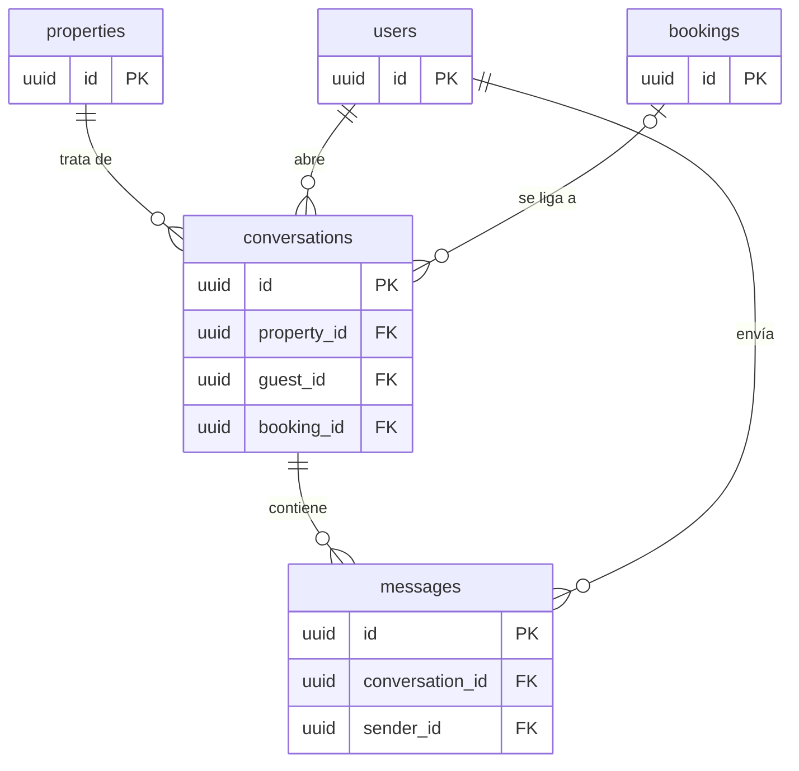
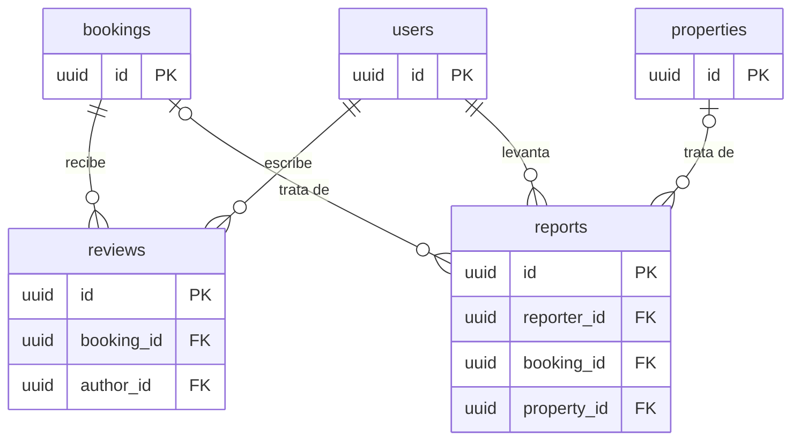

# Modelo de datos de Íntegro

Diagrama entidad-relación y modelo relacional de la base de datos. Es el plano que sigue la programación: cada tabla se construye como una migración en `database/migrations/`, grupo por grupo.

Este documento sustituye a la tabla de la sección 5 de `docs/arquitectura.md`.

## 1. Convenciones

- Motor: PostgreSQL. Nombres de tablas, columnas y valores en inglés.
- Toda tabla lleva `id` (UUID generado) como llave primaria, `created_at` y `updated_at`. En el modelo relacional de la sección 4 esas dos fechas no se repiten.
- Los montos se guardan en centavos enteros (`_cents`).
- Una llave foránea escrita como `columna → tabla(columna)` significa que el valor debe existir en la otra tabla.
- Nada se borra en cascada: una fila con datos ligados no se puede borrar.
- Estado de cada tabla: **construida** (ya existe su migración con pruebas) o **diseñada** (falta construirla).

## 2. Diagrama entidad-relación

Son 25 tablas. Primero va el diagrama general, solo con las tablas y sus relaciones, y después cinco diagramas de detalle con las llaves de cada tabla: `PK` llave primaria, `FK` llave foránea, `UK` valor único. Los demás atributos están en la sección 4. Las mismas imágenes están en la carpeta `img/`.

Cómo leer las líneas: `||` exactamente uno, `o|` cero o uno, `o{` cero o muchos.

### 2.1 Diagrama general

`stripe_events` no se relaciona con ninguna tabla: solo recuerda qué avisos de Stripe ya se procesaron.

### 2.2 Personas y acceso

### 2.3 Propiedades

### 2.4 Reservas, pagos y membresías

### 2.5 Mensajes

### 2.6 Reseñas y reportes

## 3. Relaciones y cardinalidad

"Obligatoria" indica si la llave foránea puede quedar vacía. En las relaciones de uno a uno, la columna con la llave foránea es única, y eso es lo que impide una segunda fila.

### Uno a uno

| Relación | Llave foránea | Obligatoria | Cómo se lee |
|---|---|---|---|
| `users` y `user_credentials` | `user_credentials.user_id → users(id)`, única | Sí | Una persona tiene una sola contraseña. Que toda persona tenga contraseña lo garantiza el registro, que guarda las dos filas juntas. |
| `users` y `admins` | `admins.user_id → users(id)`, única | Sí | Una persona puede ser administradora o no. |
| `users` y `host_profiles` | `host_profiles.user_id → users(id)`, única | Sí | Una persona puede ser anfitriona o no; si lo es, tiene un solo perfil. |
| `host_profiles` y `memberships` | `memberships.host_id → host_profiles(user_id)`, única | Sí | Un anfitrión tiene una sola membresía; si deja de pagar y vuelve, se reactiva la misma. |
| `properties` y `rates` | `rates.property_id → properties(id)`, única | Sí | Una propiedad tiene una sola tarifa base. |
| `bookings` y `calendar_blocks` | `calendar_blocks.booking_id → bookings(id)`, única | No | Una reserva ocupa un solo bloqueo del calendario. Los bloqueos manuales o de iCal no tienen reserva. |

### Uno a muchos

| Uno | Muchos | Llave foránea | Obligatoria | Cómo se lee |
|---|---|---|---|---|
| `users` | `sessions` | `sessions.user_id → users(id)` | Sí | Una persona puede tener varias sesiones abiertas (celular y computadora). |
| `users` | `password_resets` | `password_resets.user_id → users(id)` | Sí | Una persona puede pedir recuperar su contraseña varias veces. |
| `users` | `verifications` | `verifications.user_id → users(id)` | Sí | Una persona pasa por varias verificaciones: identidad, cuenta bancaria, tarjeta. |
| `properties` | `verifications` | `verifications.property_id → properties(id)` | No | Una propiedad pasa por varias verificaciones. Vacía cuando se verifica a la persona y no a una propiedad. |
| `host_profiles` | `properties` | `properties.owner_id → host_profiles(user_id)` | Sí | Un anfitrión es titular de varias propiedades; cada propiedad tiene un solo titular, que paga la membresía y recibe el dinero. |
| `properties` | `property_photos` | `property_photos.property_id → properties(id)` | Sí | Una propiedad tiene varias fotos. |
| `properties` | `seasonal_rates` | `seasonal_rates.property_id → properties(id)` | Sí | Una propiedad tiene varias temporadas de precio. |
| `properties` | `calendar_blocks` | `calendar_blocks.property_id → properties(id)` | Sí | Una propiedad tiene varios periodos bloqueados. |
| `properties` | `bookings` | `bookings.property_id → properties(id)` | Sí | Una propiedad recibe varias reservas. |
| `users` | `bookings` | `bookings.guest_id → users(id)` | Sí | Un huésped hace varias reservas. |
| `bookings` | `payments` | `payments.booking_id → bookings(id)` | Sí | Una reserva puede tener varios movimientos: el cobro, un reintento, un reembolso. |
| `memberships` | `membership_charges` | `membership_charges.membership_id → memberships(id)` | Sí | Una membresía genera un cobro por mes. |
| `properties` | `conversations` | `conversations.property_id → properties(id)` | Sí | Sobre una propiedad hay varias conversaciones, una por huésped. |
| `users` | `conversations` | `conversations.guest_id → users(id)` | Sí | Un huésped abre varias conversaciones, una por propiedad. |
| `bookings` | `conversations` | `conversations.booking_id → bookings(id)` | No | La conversación se liga a la reserva cuando existe; antes de reservar está vacía. |
| `conversations` | `messages` | `messages.conversation_id → conversations(id)` | Sí | Una conversación contiene varios mensajes. |
| `users` | `messages` | `messages.sender_id → users(id)` | Sí | Una persona envía varios mensajes. |
| `bookings` | `reviews` | `reviews.booking_id → bookings(id)` | Sí | Una reserva recibe hasta dos reseñas: la del huésped y la del anfitrión. |
| `users` | `reviews` | `reviews.author_id → users(id)` | Sí | Una persona escribe varias reseñas, una por reserva. |
| `users` | `reports` | `reports.reporter_id → users(id)` | Sí | Una persona puede levantar varios reportes. |
| `bookings` | `reports` | `reports.booking_id → bookings(id)` | No | Un reporte puede tratar de una reserva. |
| `properties` | `reports` | `reports.property_id → properties(id)` | No | Un reporte puede tratar de un anuncio sin que exista reserva. |
| `users` | `audit_log` | `audit_log.actor_id → users(id)` | No | Una persona deja varias entradas en la bitácora. Vacía cuando actuó el sistema. |

### Muchos a muchos

Una relación de muchos a muchos no se puede guardar con una sola llave foránea. Se resuelve con una tabla intermedia que tiene dos llaves foráneas, y la pareja no se puede repetir.

| Entre | Tabla intermedia | Llaves foráneas | Cómo se lee |
|---|---|---|---|
| `host_profiles` y `properties` (coanfitriones) | `property_co_hosts` | `property_id → properties(id)` y `host_id → host_profiles(user_id)`; la pareja es única | Una propiedad tiene varios coanfitriones y un anfitrión ayuda en varias propiedades. El coanfitrión edita, responde mensajes y maneja el calendario; no toca dinero. |
| `properties` y `amenities` | `property_amenities` | `property_id → properties(id)` y `amenity_id → amenities(id)`; la pareja es única | Una propiedad ofrece varios servicios y un servicio (wifi, cocina) se ofrece en muchas propiedades. |

## 4. Modelo relacional

Notación: `tabla(columnas)`. La llave primaria va <ins>subrayada</ins>. `FK` marca una llave foránea, `UK` un valor único y `?` una columna que puede quedar vacía.

### Grupo 1. Personas y acceso

Estado: `users`, `user_credentials`, `host_profiles` y `verifications` construidas; `sessions`, `password_resets` y `admins` diseñadas.

- **users**(<ins>id</ins>, first_name, last_name, email UK, phone UK, country, birth_date, preferred_language, identity_status)
- **user_credentials**(<ins>id</ins>, user_id FK UK → users(id), password_hash)
- **sessions**(<ins>id</ins>, user_id FK → users(id), token_hash UK, expires_at, revoked_at?)
- **password_resets**(<ins>id</ins>, user_id FK → users(id), token_hash UK, expires_at, used_at?)
- **admins**(<ins>id</ins>, user_id FK UK → users(id))
- **host_profiles**(<ins>id</ins>, user_id FK UK → users(id), level, stripe_account_id? UK, clabe_last4?)
- **verifications**(<ins>id</ins>, user_id FK → users(id), property_id? FK → properties(id), kind, provider, provider_reference, result, resolved_at?)
  - Única la pareja (provider, provider_reference). `property_id` se agrega en el grupo 2.

### Grupo 2. Propiedades

Estado: diseñadas.

- **properties**(<ins>id</ins>, owner_id FK → host_profiles(user_id), title, description, property_type, capacity, bedrooms, beds, bathrooms, house_rules, city, zone, exact_address, approximate_location, cancellation_policy, status)
- **property_co_hosts**(<ins>id</ins>, property_id FK → properties(id), host_id FK → host_profiles(user_id))
  - Única la pareja (property_id, host_id).
- **property_photos**(<ins>id</ins>, property_id FK → properties(id), file_path, position)
  - Única la pareja (property_id, position).
- **rates**(<ins>id</ins>, property_id FK UK → properties(id), nightly_price_cents, cleaning_fee_cents, minimum_nights)
- **seasonal_rates**(<ins>id</ins>, property_id FK → properties(id), name, start_date, end_date, nightly_price_cents)
  - Dos temporadas de la misma propiedad no se pueden encimar.
- **amenities**(<ins>id</ins>, code UK, name_es, name_en)
- **property_amenities**(<ins>id</ins>, property_id FK → properties(id), amenity_id FK → amenities(id))
  - Única la pareja (property_id, amenity_id).

### Grupo 3. Calendario y reservas

Estado: diseñadas.

- **calendar_blocks**(<ins>id</ins>, property_id FK → properties(id), booking_id? FK UK → bookings(id), start_date, end_date, source)
  - `source`: manual, ical o booking. Dos bloqueos de la misma propiedad no se pueden encimar.
- **bookings**(<ins>id</ins>, property_id FK → properties(id), guest_id FK → users(id), check_in, check_out, guests_count, total_cents, status)

### Grupo 4. Pagos

Estado: diseñadas.

- **payments**(<ins>id</ins>, booking_id FK → bookings(id), amount_cents, status, reason?, stripe_reference? UK, idempotency_key UK)
- **stripe_events**(<ins>id</ins>, stripe_event_id UK, event_type, received_at, processed_at?)

### Grupo 5. Membresías

Estado: diseñadas.

- **memberships**(<ins>id</ins>, host_id FK UK → host_profiles(user_id), plan, status, period_start, period_end, failed_attempts)
- **membership_charges**(<ins>id</ins>, membership_id FK → memberships(id), amount_cents, status, stripe_reference? UK, invoice_reference?)

### Grupo 6. Mensajes, reseñas, reportes y bitácora

Estado: diseñadas.

- **conversations**(<ins>id</ins>, property_id FK → properties(id), guest_id FK → users(id), booking_id? FK → bookings(id))
  - Única la pareja (property_id, guest_id).
- **messages**(<ins>id</ins>, conversation_id FK → conversations(id), sender_id FK → users(id), body, status, sent_at, read_at?)
  - `status`: sent, read o held.
- **reviews**(<ins>id</ins>, booking_id FK → bookings(id), author_id FK → users(id), rating, body)
  - Única la pareja (booking_id, author_id).
- **reports**(<ins>id</ins>, reporter_id FK → users(id), booking_id? FK → bookings(id), property_id? FK → properties(id), reason, description, status, resolution?)
- **audit_log**(<ins>id</ins>, actor_id? FK → users(id), action, entity_type, entity_id)
  - Solo se inserta; nunca se edita ni se borra.

## 5. Propuestas incluidas que esperan decisión

Están dibujadas en el diagrama, pero no venían en las tablas autorizadas el 17 de noviembre de 2026.

| # | Propuesta | Por qué |
|---|---|---|
| 1 | El titular va en `properties.owner_id` y los coanfitriones en `property_co_hosts` | Así la base garantiza que cada propiedad tiene exactamente un titular. |
| 2 | Las llaves foráneas de anfitrión apuntan a `host_profiles(user_id)` y no a `users(id)` | Nadie puede ser titular, coanfitrión o tener membresía sin perfil de anfitrión. |
| 3 | `conversations` no lleva columna de anfitrión | Con coanfitriones, el lado anfitrión es quien atienda la propiedad; quién escribió queda en `messages.sender_id`. |
| 4 | `calendar_blocks.booking_id` | Liga el bloqueo con la reserva que lo causó, para liberarlo si la reserva se cancela. |
| 5 | `reports.property_id` | El prototipo tiene "Reportar este anuncio", que ocurre sin reserva. |
| 6 | Columnas de `sessions` y `password_resets` | Se guarda la huella del código, no el código, igual que con las contraseñas. |
| 7 | `amenities` con `name_es` y `name_en` | La plataforma funciona en español e inglés. |
| 8 | Nombres `memberships` y `membership_charges` | `docs/arquitectura.md` las llamaba `subscriptions` e `invoices`. |

## 6. Lo que falta decidir antes de construir

- **Listas de estados.** `properties.status`, `bookings.status`, `payments.status` y `memberships.status` son máquinas de estados cerradas. Cada una necesita su tabla de estados y cambios permitidos antes de su migración.
- **Tablas que no están en este modelo:** calendarios iCal por propiedad, llaves digitales y registro de aperturas de la chapa inteligente, comprobación del correo al registrarse y eventos de uso (búsquedas, clics).
